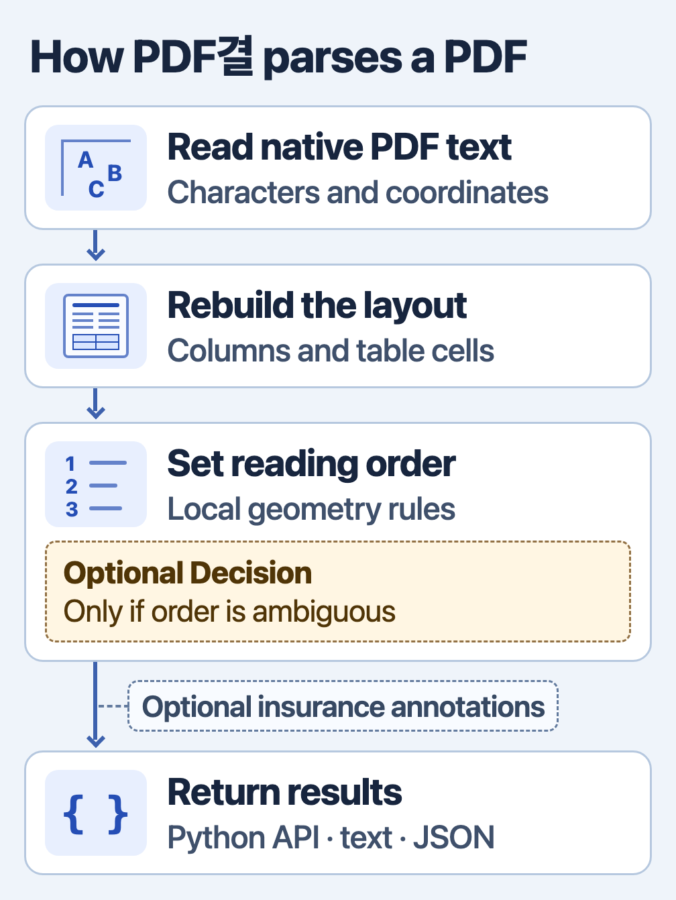

**Use pdfgyeol to recover the reading order of multi-column PDFs and trace each extracted table cell back to its source on the page.**

[한국어](README.md) · **English**

<p align="center">
  
</p>

<h1 align="center">pdfgyeol</h1>

pdfgyeol (PDF결) is a Python tool that uses character positions to distinguish headings, text columns, and tables. Get text in reading order or export UTF-8 JSON with source character coordinates and table cells. Once installed, default parsing runs locally without an API key or network access.

## Features

- **Reading order.** Reconstruct the order from headings and column layout. Extracted text retains references to the source characters and their coordinates.
- **Table structure.** Extract rows and cells, including merged cells, empty cells, and nested tables. Each cell links back to its source content.
- **Optional Decision scoring.** Compare candidate reading orders for regions where the layout is ambiguous. [Configuration and data sent](#optional-decision-scoring)

## How the parser works

<a href="docs/parser-flow.en.png"></a>

The parser uses characters and their coordinates to identify columns and tables and infer their order on each page. When enabled, Decision scores candidates only for regions with ambiguous reading order. Insurance policy annotations are added after the final reading order is set. To inspect the inputs and outputs at each step, download the HTML file and open it in a browser. [Interactive diagram (Korean)](docs/parser-flow.html)

## Results on real PDFs

| Measure | pdfgyeol default | pdfplumber default | PyMuPDF default |
| --- | ---: | ---: | ---: |
| Reference phrase pairs in the correct order across 6 insurance policy pages | 90/90 | 84/90 | 86/90 |
| Reference phrase pairs in the correct order across 8 non-insurance pages | 60/80 | 51/80 | 60/80 |
| Train timetable entries with the correct time for the station and train | 0/12 | 12/12 | 12/12 |

pdfgyeol and PyMuPDF got all 60 phrase pairs right in the public health handout, tax form, and research paper. All three parsers missed the 20 phrase pairs embedded in images. pdfgyeol recovered all 51 number-and-item-name pairs in an insurance policy table. It skipped the train timetable because the page exceeded the default line-segment limit. Raising that limit to 1,600 recovered all 12 benchmark cells on the same page. [Sources and reproduction steps for five non-insurance domains (Korean)](docs/benchmarks-general.md) · [Results by anonymized insurer and processing times (Korean)](docs/benchmarks-insurance.md)

## Installation

**Python 3.11 or later** is required. Clone the repository from GitHub.

```sh
git clone https://github.com/choijhyeok/pdfgyeol.git
cd pdfgyeol
```

To try the integration PR before it merges, switch to this branch before installing. After the merge, install directly from the default `main` branch.

```sh
git switch choijhyeok/feature/pdfgyeol-v1
```

From the repository root, create a virtual environment and install the package. The activation command below is for macOS and Linux. In Windows PowerShell, run `.venv\Scripts\Activate.ps1`.

```sh
python3 -m venv .venv
. .venv/bin/activate
python -m pip install .
```

On Windows, you can create the virtual environment with `py -3 -m venv .venv`. Installation requires access to download build and runtime dependencies.

## Quick start

### Save JSON with the CLI

The one-page example contains two columns of riverside field notes and a table of water depths. The generator uses only the Python standard library. Run these commands from the repository root. [Example generator](examples/make_riverside_notes.py)

```sh
python examples/make_riverside_notes.py riverside-notes.pdf
pdfgyeol riverside-notes.pdf --output riverside-notes.json
```

Omit `--output` to write JSON to standard output. When saving to a file, specify a new output path. To parse your own PDF, replace the first argument to `pdfgyeol` with its path.

### Inspect reading order and tables in Python

```python
from pdfgyeol import parse_pdf

document = parse_pdf("riverside-notes.pdf")
page = document.pages[0]
table = page.layout.tables[0]

print(page.text)
print()
for row in table.rows:
    print([page.cell_text(cell.id) for cell in row.cells])
```

The PDF draws the right column first. The parser reads the title, left column, right column, and table in that order. The last three lines show the rows and cells of the same table.

```text
Riverside field notes
Morning fog covered the west bank.
The footpath opened after sunrise.
Two herons stood near the reeds.
The west team finished at nine.
Wind picked up on the east bank.
The team walked past the bridge.
They noted ripples by the sluice.
The east team finished at ten.
Bank
Depth (cm)
West
42
East
36

['Bank', 'Depth (cm)']
['West', '42']
['East', '36']
```

Use `document.to_dict()` or `document.to_json()` to get the same structure as the CLI output. Find region order in `pages[].layout.reading_order`. Follow references from regions to lines to look up source characters and coordinates in `pages[].source.fragments`. [API and JSON structure (Korean)](docs/api-cli.md#구조와-읽기-순서)

## Optional Decision scoring

Decision is off by default. Set `pdfgyeol.host` to score ambiguous regions in subsequent `parse_pdf()` calls. For Azure System One, supply the deployment's full scoring URL and API key.

```python
import os
import pdfgyeol

pdfgyeol.host = "ms"
pdfgyeol.endpoint = os.environ["AZURE_OPENAI_ENDPOINT"]
pdfgyeol.apikey = os.environ["AZURE_OPENAI_API_KEY"]
pdfgyeol.model = os.getenv("DECISION_MODEL_DEPLOYMENT")  # Defaults to Decision-1.1
document = pdfgyeol.parse_pdf("riverside-notes.pdf")
```

`"jev"` and `"openai"` provide default scoring URLs and use their respective service keys. For `"custom"` or `"local"`, supply a compatible scoring URL. Set `pdfgyeol.host = None` to clear the host selection, or pass `decision_config=pdfgyeol.DecisionConfig(enabled=False)` to turn Decision off for one call. The CLI uses `--decision` and the existing Azure environment variables. [Provider settings and local Ollama example (Korean)](docs/decision.md#명시적-설정과-전송-범위)

When the parser finds distinct valid candidates, it sends limited text excerpts, layout information, and the candidate orders for that region to the scoring endpoint. The response scores existing candidates. The parser keeps the order inferred from page geometry if scoring fails or the score margin is too small. The JSON records selections and deferrals.

Decision made **0 reading-order corrections** on six held-out synthetic documents. pdfgyeol retains the default thresholds. [Decision validation results (Korean)](docs/decision-validation.md)

## Supported layouts and limitations

pdfgyeol works with PDFs that have a text layer. It records image positions on image-only pages and does not run OCR. It primarily supports horizontal, left-to-right layouts. Reading order or cell assignments can be wrong with vertical text, right-to-left layouts, or tables with incomplete or missing borders. [Layout rules and limitations (Korean)](docs/layout.md#검증과-한계)

For Korean insurance policies, use `--insurance` or `parse_pdf(..., insurance=True)` to see which articles, riders, or schedules the text belongs to. This option adds local annotations that reference the existing lines. [Insurance policy option (Korean)](docs/insurance.md)

## Documentation

- [Python API, CLI, and JSON format (Korean)](docs/api-cli.md)
- [Source characters, coordinates, and page metadata (Korean)](docs/extraction.md)
- [Layout rules for columns, regions, and tables (Korean)](docs/layout.md)
- [Decision configuration and validation (Korean)](docs/decision.md)

## License

pdfgyeol and the riverside field notes example are available under the [MIT License](LICENSE).
